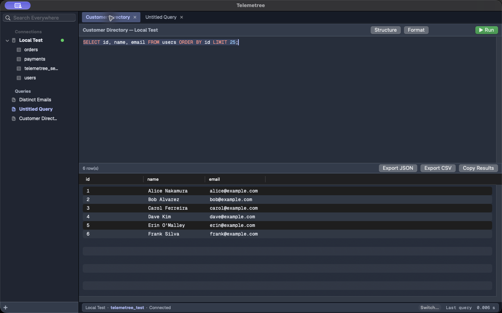

# Telemetree

> Your queries are work, not scratch paper.




Telemetree is a native macOS database IDE for MySQL, PostgreSQL and SQLite,
built around persistent, named query documents, schema-aware SQL assistance,
and a genuinely native AppKit interface, keyboard-first throughout.

**[felipepkgs.github.io/telemetree](https://felipepkgs.github.io/telemetree/)**

## What it does

- **MySQL, PostgreSQL &amp; SQLite** — three real engine implementations
  (engine-specific identifier quoting, error translation, schema
  browsing), not a MySQL client with the others faked.
- **Query documents, not tabs.** Every query is a named, persistent
  document — close the app and reopen it, and your workspace is exactly
  how you left it.
- **Statement-aware execution.** Run (⌘Return) only ever fires the
  statement under your cursor — or your selection — never the rest of the
  buffer. Multi-statement documents are safe by default.
- **Destructive SQL confirmation.** `DELETE` / `DROP` / `TRUNCATE`, and any
  `UPDATE`, require Touch ID (or your password) before they run.
- **Inline cell editing.** Double-click a result cell (real primary key
  required) to edit it in place — Touch ID confirms the exact old → new
  value before the UPDATE runs.
- **Foreign key click-to-navigate.** Option-click a FK cell to jump to its
  referenced row in the other table, backed by real schema introspection.
- **Session &amp; activity monitor.** Live view of a MySQL/PostgreSQL
  server's active connections and queries, auto-refreshing.
- **Command palette** (`⌘⇧P`) — jump to queries, connections, active-database
  tables, or actions without leaving the keyboard.
- **Query history.** Every run is logged — searchable, reopenable as a new
  document.
- **Color labels.** An 8-color palette for connections, queries and
  folders, from each row's context menu.
- **GitHub-style SQL colors.** GitHub Light and GitHub Dark palettes, plus
  Geist Mono / SF Mono / Menlo at 10–18pt, all live in Preferences.
- **SQL autocomplete** — keywords and schema-backed table/column names,
  including common aliases, scoped to the statement under your cursor.
  Tab-only accept; no third-party editor dependency.
- **Workspace chooser** — select a connection and database on launch;
  switch later from the status bar or with `⌘⇧K`. Tables appear directly
  under the active connection rather than in a deep database tree.
- **Quick structure and formatting** — inspect a table definition in a
  popover or format just the selected/current statement.
- **Numbered pagination.** Large tables page in 100 rows at a time
  ("1-100 of 10,000"), instead of pulling an entire result set into memory.
- **Export CSV/JSON**, alongside plain copy-to-clipboard.
- **Clear Light/Dark appearance** with a native, neutral workspace hierarchy.
- **Workspace status bar** — active connection, database, and latest query
  execution time stay visible at the bottom of the window.
- **Keychain-backed credentials.** Passwords never touch disk in
  plaintext; no account, no cloud, nothing phones home.

## Why I built this

TablePlus-style disposable tabs don't match how queries actually get used —
a query worth running once a week deserves to persist as a real document,
not evaporate when a tab closes. Telemetree is built around named query
documents, schema-aware SQL work, and a focused native database workflow.

## Install

```sh
brew tap felipepkgs/telemetree
brew install --cask telemetree
```

Ad-hoc signed, not notarized — Gatekeeper will flag the first launch; the
cask clears the quarantine flag automatically. Or build from source:

```sh
swift build
swift run
```

Pure Swift Package Manager, no Xcode project required. Targets macOS 14+.

## Docs

- [Site](https://felipepkgs.github.io/telemetree/) — features, themes,
  screenshots, honest shipped-vs-not status
- [Spec](SPEC.md) — milestone roadmap and implementation addenda, updated
  as the app grows

## Credits

Icons (`Sources/Telemetree/Resources/Icons/`) are by
[Icons8](https://icons8.com), used under their free license. Editor and UI
type is [Geist / Geist Mono](https://vercel.com/font).
